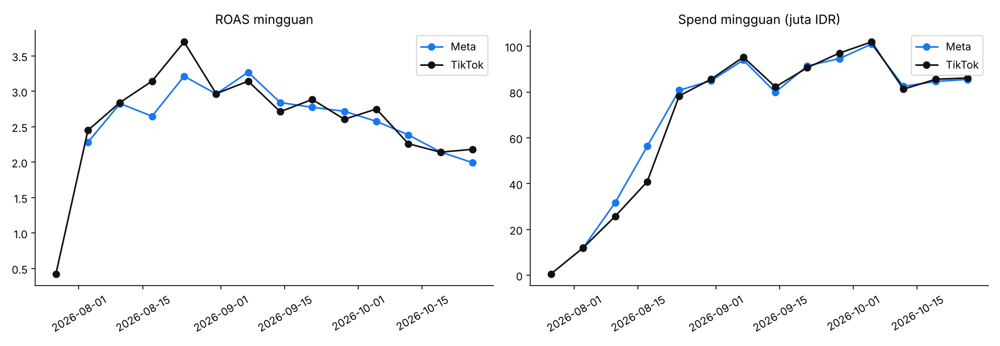
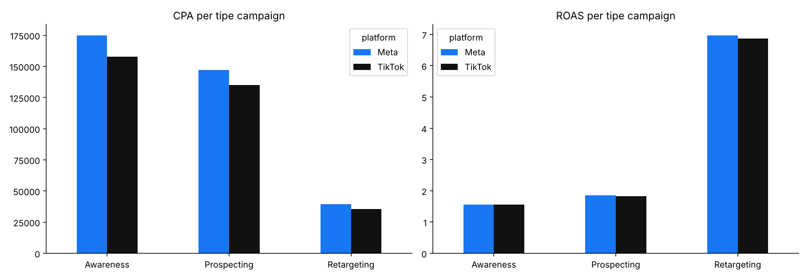
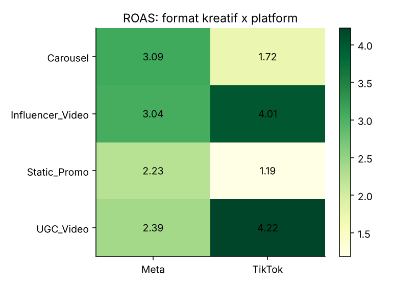
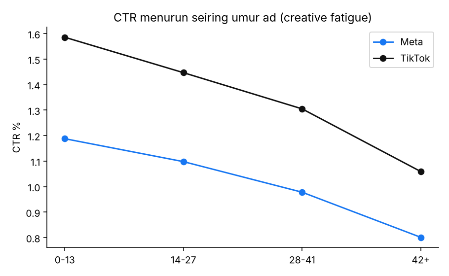
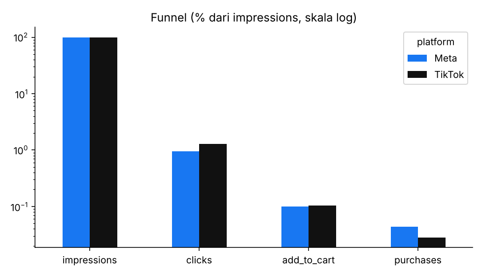

Analisis Performa Iklan Meta Ads vs TikTok Ads
> **Catatan:** Seluruh data di project ini adalah **data sintesis** yang saya buat untuk mensimulasikan format export Meta Ads Manager dan TikTok Ads Manager. Brand dan angkanya fiktif (fashion e-commerce Indonesia, mata uang IDR, periode 1 Agustus - 31 Oktober 2026). Tujuan project ini adalah menunjukkan alur kerja analisis iklan, bukan mengklaim hasil dari klien nyata.
Pertanyaan bisnis
Budget iklan dibagi ke dua platform, Meta dan TikTok. Platform dan jenis kreatif mana yang paling efisien, dan ke mana budget sebaiknya digeser?
Pendekatan
Pengambilan data: membuat dua file export dengan struktur kolom yang berbeda, seperti kondisi asli (`Amount spent (IDR)` vs `spend`, `Purchases` vs `complete_payment`, format tanggal berbeda).
Pembersihan (ETL): menyamakan nama kolom dan tanggal, membuang duplikat, merapikan nama campaign, mengisi nilai yang hilang, lalu menggabungkan semuanya menjadi satu tabel (4.180 baris).
Analisis: menghitung CPM, CTR, CPC, CVR, CPA, ROAS, dan AOV. Rasio dihitung dari total (jumlahkan dulu, baru dibagi), bukan rata-rata rasio harian. Perbandingan platform diuji dengan Welch t-test.
Rekomendasi: disusun dari hasil per platform, tipe campaign, dan format kreatif.
Temuan utama
#	Temuan	Angka
1	Meta dan TikTok setara secara efisiensi	ROAS 2,69 vs 2,75 (p = 0,63, tidak signifikan)
2	Cara mencapainya berbeda	TikTok: CPM dan CPC lebih murah. Meta: CVR lebih tinggi (4,5% vs 2,2%)
3	Retargeting jauh lebih efisien dari prospecting	ROAS sekitar 7 vs sekitar 1,8 di kedua platform
4	Format kreatif bekerja beda per platform	TikTok: UGC Video 4,22 dan Influencer Video 4,01, Static Promo hanya 1,19. Meta: Carousel 3,09 dan Influencer Video 3,04
5	Creative fatigue nyata	CTR turun sekitar 33% pada ad yang berumur lebih dari 42 hari
6	Hari event (9.9 dan 10.10) menurunkan CPA	Meta sekitar 19%, TikTok sekitar 22%
Visualisasi
Tren mingguan ROAS dan spend

CPA dan ROAS per tipe campaign

ROAS per format kreatif dan platform

Creative fatigue

Funnel

Rekomendasi
TikTok: kurangi budget Static Promo dan Carousel, alihkan ke UGC Video dan Influencer Video.
Meta: prioritaskan Carousel dan Influencer Video, kurangi Static Promo di campaign prospecting.
Retargeting: naikkan budget secara bertahap sambil memantau frekuensi dan ROAS, karena ukuran audiensnya terbatas.
Kreatif: jadwalkan pergantian kreatif sekitar setiap 4 minggu agar CTR tidak turun jauh.
Event: siapkan budget lebih besar dan kreatif baru 2-3 hari sebelum tanggal kembar.
Keterbatasan
Data sintesis, sehingga pola di dalamnya mengikuti asumsi saya, bukan perilaku pasar nyata.
Meta dan TikTok memakai jendela atribusi berbeda, jadi perbandingan ROAS pada data nyata perlu diperlakukan hati-hati.
Analisis ini tidak mengukur kontribusi inkremental iklan (misalnya lewat uji holdout).
Dashboard
[Tambahkan link dashboard Looker Studio di sini]
Struktur project
File	Fungsi
`01_generate_data.py`	Membuat data export Meta dan TikTok (sintesis)
`02_etl_clean.py`	Membersihkan dan menggabungkan data
`03_analysis.py`	Menghitung KPI, uji statistik, dan membuat chart
`data/raw/`	Data mentah
`data/clean/ads_unified.csv`	Data gabungan siap analisis
`reports/`	Tabel KPI dan chart
Cara menjalankan: `pip install pandas numpy matplotlib scipy`, lalu `python 01_generate_data.py && python 02_etl_clean.py && python 03_analysis.py`
Alat yang dipakai
Python (pandas, numpy, matplotlib, scipy), Looker Studio.
